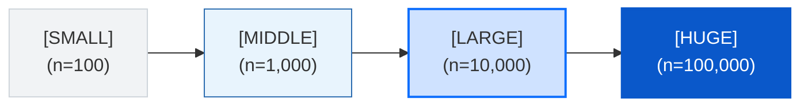
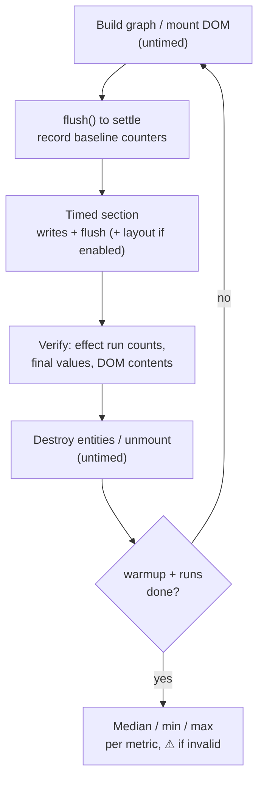

# @watervein/benchmark

The structural verification and stress-testing suite for the Watervein reactive ecosystem. It measures dependency-graph construction and propagation, fan-in/fan-out profiles, `For` list reconciliation, dependency switching, entity destruction, and the cost of dynamic (reactive) element properties in the DOM layer.

Every case **validates that the work it claims to measure actually happened** (effect run counts, final values, DOM contents), and reports the **median of repeated runs** rather than a single sample.

---

## Benchmark Philosophy

Watervein skips the Virtual DOM entirely and instead leverages a graph-driven Reactive Entity Component System (ECS). To make the numbers trustworthy and comparable between commits, the suite follows these rules:

1. **Measure what the label says.** Each case settles the graph (`UISystem.flush()`) before timing, then times the update _including_ its flush. Writes always change the value, so they are never silently dropped by redundant-write filtering. Each case asserts the expected number of effect runs, and a case that fails is printed as `⚠ INVALID`; do not trust its numbers.
2. **Report medians, not single runs.** Each case runs `warmup` rounds (discarded, to let the JIT settle) and then `runs` rounds. The median, min and max are printed.
3. **Respect the clock.** The timer resolution is printed at startup. Results close to the resolution are flagged `⚠near-timer-resolution`; large cases are sized so per-op numbers (ns/op, µs/op) stay meaningful.
4. **Separate phases.** Where one case covers several phases (build, update, destroy), each is timed separately. Watervein evaluates computes and runs effects eagerly (the sanity checks confirm this), so there is no separate lazy "first read" phase to time.
5. **No hidden duplicates.** In the scale sweep, a parameter that is capped to the same value as a smaller level is skipped instead of being measured again under a bigger label.

---

## Environment

For meaningful numbers:

| Requirement                                                                                                     | Why                                                                                                |
| :-------------------------------------------------------------------------------------------------------------- | :------------------------------------------------------------------------------------------------- |
| **Production build** (`vite build && vite preview`)                                                             | Dev builds include inspection code and are slower.                                                 |
| **COOP/COEP headers** (`Cross-Origin-Opener-Policy: same-origin`, `Cross-Origin-Embedder-Policy: require-corp`) | Makes `crossOriginIsolated` true so `performance.now()` has about 5µs resolution instead of 100µs. |
| **DevTools closed, other tabs closed**                                                                          | Avoids measurement noise.                                                                          |
| `chrome --js-flags=--expose-gc --enable-precise-memory-info`                                                    | Only needed for `runWaterveinLeakCheck()`.                                                         |

> `performance.memory` is coarse unless launched with the flags above. Single-run `Δheap` numbers are therefore **not** reported by the timing suites; use the leak check instead.

---

## Running the Tests

Import the test runner bundle inside your web runtime shell. It registers three async entry points on `window`:

```typescript
import '@watervein/benchmark';

// 1. Sanity checks + the standard suite
await window.runWaterveinBenchmark();

// 2. The scale sweep (SMALL -> HUGE)
await window.runWaterveinScaleBenchmark();

// 3. Leak check (requires --expose-gc)
await window.runWaterveinLeakCheck();
```

### Options

`runWaterveinBenchmark` and `runWaterveinScaleBenchmark` accept:

| Option          | Default           | Description                                                                                           |
| :-------------- | :---------------- | :---------------------------------------------------------------------------------------------------- |
| `warmup`        | `3` (scale: `2`)  | Rounds discarded before measuring.                                                                    |
| `runs`          | `15` (scale: `7`) | Measured rounds; the median is reported.                                                              |
| `includeLayout` | `false`           | Force layout (`offsetHeight`) inside DOM timings, so the numbers include layout and not just JS work. |
| `only`          | –                 | Run only cases whose id or title contains this text, e.g. `{ only: 'fan' }`.                          |

Results are also stored in `window.__waterveinBenchResults`:

```typescript
copy(JSON.stringify(window.__waterveinBenchResults));
```

---

## Sanity Checks

Before the timing cases, the suite verifies the assumptions the numbers depend on, and prints whether effects run eagerly on creation or on the next flush:

- a write triggers exactly one effect run
- an identical write is filtered
- `batch` coalesces multiple writes
- a destroyed entity stops reacting

If any of these fails, the suite warns that the numbers below may not mean what their labels say.

---

## Key Metrics Captured

| Case id                        | Strategy & target                                                                                  | What it verifies                                                                   |
| :----------------------------- | :------------------------------------------------------------------------------------------------- | :--------------------------------------------------------------------------------- |
| **`dag`**                      | Builds a two-lane dependency graph, then times build and update separately.                        | Node allocation (including eager evaluation) and propagation through a long graph. |
| **`highfreq`**                 | Thousands of independent state → compute → effect chains, updated one `batch` + `flush` per frame. | Per-write overhead under frame-based updates.                                      |
| **`destroy`**                  | Individual vs. batched entity destruction, alternating which goes first.                           | Entity teardown cost, without ordering bias.                                       |
| **`dom-mount`**                | Mounts elements with reactive style and text.                                                      | Cost of creating reactive DOM nodes.                                               |
| **`for-reverse`**              | Reverses a keyed `For` list and checks the resulting DOM order.                                    | Keyed reorder cost.                                                                |
| **`for-replace`**              | Replaces 10% and 50% of a keyed list.                                                              | Node reuse and stable key handling.                                                |
| **`for-reset`**                | Clears and repopulates a list, timed separately.                                                   | List teardown vs. rebuild.                                                         |
| **`for-single`**               | Updates one item's state per flush.                                                                | Fine-grained update latency inside a list.                                         |
| **`for-all`**                  | Updates every item's state in one frame (dashboard-like).                                          | Throughput of per-item fine-grained updates at scale.                              |
| **`dyn-dep`**                  | Flips a condition so the read dependency of a compute changes each frame.                          | Dynamic dependency tracking.                                                       |
| **`edge-cleanup`**             | Toggles a flag so every compute swaps the state it reads.                                          | Cost of unlinking and relinking dependency edges.                                  |
| **`fan-out` / `fan-in`**       | One state → N effects, and N states → one compute.                                                 | Broadcast and gather propagation.                                                  |
| **`deep-chain`**               | A 10,000-step compute chain (build and update).                                                    | Deep propagation, and stack-depth safety.                                          |
| **`diamond`**                  | Wide diamond graph; checks the effect ran once with the correct value.                             | Glitch-free propagation.                                                           |
| **`redundant`**                | Many identical writes; checks the effect never runs.                                               | Redundant write filtering.                                                         |
| **`read` / `write` / `flush`** | Untracked reads, writes with no subscribers, and empty flushes.                                    | Primitive operation cost.                                                          |
| **`create`**                   | Creating states, computes, and effects.                                                            | Allocation cost.                                                                   |
| **`dsl-props`**                | Static vs. dynamic element properties, plus the cost of updating bound styles.                     | The cost of reactive props in the DOM layer.                                       |
| **`cross-entity`**             | Computes in child entities that depend on a global state; create, propagate, destroy separately.   | Cross-entity dependency and cascade destruction.                                   |

---

## Multi-Scale Evaluation Levels

`runWaterveinScaleBenchmark()` sweeps four load levels and reports how each case behaves as the graph grows:



- `SMALL` & `MIDDLE`: standard application view scopes; focus on base reaction overhead.
- `LARGE`: high-density interactive data or heavy real-time tables.
- `HUGE`: the stress barrier, for raw graph construction speed and extreme fan-out limits.

Some cases cap their size (for example `For` lists at 5,000–10,000 items, fan-out at 50,000). The actual size is printed in each case title, and a level whose capped size equals one already measured is skipped rather than re-measured.

Read the sweep by comparing **per-op** numbers across levels: a flat per-op cost means linear scaling, a growing one means a super-linear cost.

---

## Measurement Protocol



---

## Leak Check

`runWaterveinLeakCheck()` repeats three workloads (entity create and destroy, `For` mount and unmount, DAG build and destroy) 20 times each, forces a GC, and prints the heap delta after rounds 5, 10, 15 and 20. A steady upward trend suggests a leak; a flat line is healthy.

It requires `--expose-gc` and `--enable-precise-memory-info`; otherwise it prints how to launch Chrome and exits.

---

## Interpreting Results

- **Trust only `✓` cases.** An `⚠ INVALID` case measured something other than what its label says.
- **Prefer per-op numbers** when comparing across sizes or against other libraries.
- **Compare like with like.** Numbers from different machines, browsers, build modes, or `includeLayout` settings are not comparable.
- **These numbers measure JS work** unless `includeLayout` is on, and even then not paint or compositing. For end-to-end frame cost, use the DevTools Performance panel.

## License

This project is licensed under either of:

- Apache License, Version 2.0 ([LICENSE-APACHE](LICENSE-APACHE) or http://www.apache.org/licenses/LICENSE-2.0)
- MIT license ([LICENSE-MIT](LICENSE-MIT) or http://opensource.org/licenses/MIT)

at your option.
